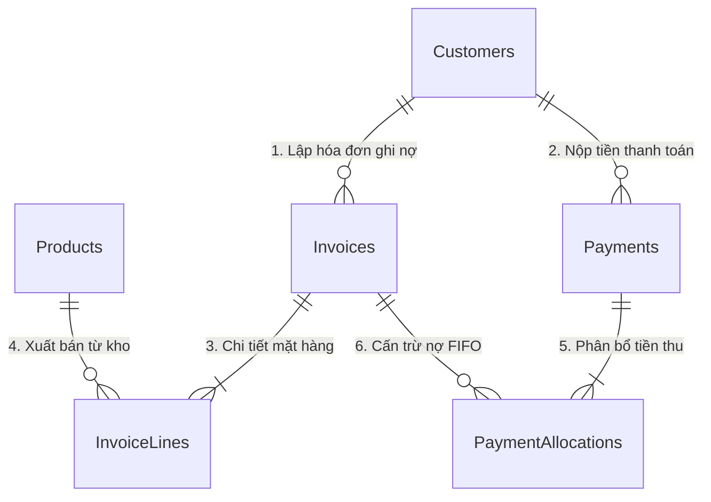

# BÁO CÁO KHẢO SÁT & BẢN TẢ KIẾN TRÚC TOÀN DIỆN DỰ ÁN
## ĐỒ ÁN CAPSTONE ECO2415 — ĐỀ TÀI 18: HỆ THỐNG BÁN HÀNG & QUẢN TRỊ CÔNG NỢ B2B (HUEGO B2B)

- **Ngày giờ khảo sát:** 2026-10-21 12:30:00 (UTC+7)
- **Commit Git hiện tại:** `4a63add` (Nhánh: `main`)
- **Vai trò thực hiện:** Software Architect & Technical Writer
- **Mục đích:** Khảo sát độc lập, khách quan toàn bộ mã nguồn thật để cung cấp bức tranh kiến trúc chuẩn xác 100% phục vụ chuyên gia đánh giá và tư vấn tiếp theo.

---

## 1. TỔNG QUAN

### 1.1. Mục Tiêu & Miền Nghiệp Vụ
Dự án giải quyết bài toán cốt lõi trong chuỗi phân phối bán buôn (B2B Wholesale FMCG): Quản trị công nợ bán chịu gối đầu, kiểm soát hạn mức tín dụng thương mại của đại lý, phân bổ tự động tiền thu theo nguyên tắc FIFO (hóa đơn cũ cấn trừ trước), phân loại tuổi nợ 4 nhóm (Aging Buckets) và phân tích lãi gộp theo giá vốn thực tế.

### 1.2. Nền Tảng Công Nghệ & Phiên Bản
* **Framework:** .NET 8.0 (`net8.0`), C# 12.
* **Giao diện Web:** Blazor Server tương tác thời gian thực (`InteractiveServerComponents`, SignalR).
* **Kiểu render:** Interactive Server Mode kết hợp Static SSR trên Landing Page / Login.
* **ORM & Truy cập dữ liệu:** Dapper version `2.1.89` kết hợp `Microsoft.Data.SqlClient` version `7.1.1` (sử dụng 100% truy vấn SQL thuần có tham số hóa).
* **Cơ sở dữ liệu:** Microsoft SQL Server 2022 (phiên bản chạy thực tế: SQL Server 16.0.1000 - Express Edition `.\SQLEXPRESS`).
* **Framework UI:** Bootstrap version `5.3.x` (`bootstrap.min.css`), kèm hệ thống Custom Tokens CSS, hỗ trợ Responsive 390px đến 1920px.
* **Biểu tượng (Icons):** Bootstrap Icons `1.11.3` (nạp qua CDN jsDelivr).
* **Phông chữ:** Inter và Plus Jakarta Sans (được tải cục bộ dạng file `woff2` trong `wwwroot/fonts/`).

### 1.3. Danh Sách Package NuGet Đang Dùng
* Trong `WebBanHang.CoreBusiness.csproj`: **0 Package** (Thư viện thuần C# .NET 8).
* Trong `WebBanHang.UseCases.csproj`: **0 Package** (Chỉ phụ thuộc `CoreBusiness`).
* Trong `WebBanHang.Plugins.DataStore.SQL.csproj`:
  - `Dapper` (2.1.89)
  - `Microsoft.Data.SqlClient` (7.1.1)
  - `Microsoft.Extensions.Configuration.Abstractions` (10.0.12)
* Trong `WebBanHang.csproj`: **0 Package ngoài** (Sử dụng SDK `Microsoft.NET.Sdk.Web` tích hợp sẵn trong .NET 8).

### 1.4. Cách Khởi Chạy Dự Án
1. **Khởi động SQL Server:** Đảm bảo instance `.\SQLEXPRESS` đang hoạt động, CSDL `CSDLBANHANG` đã được import từ kịch bản `WebBanHang/CSDLBANHANG.sql`.
2. **Lệnh chạy:**
   ```bash
   cd WebBanHang/WebBanHang
   dotnet run
   ```
3. **Cổng & URL truy cập:**
   - HTTPS: `https://localhost:7176`
   - HTTP: `http://localhost:5070`
4. **Tài khoản demo có sẵn (Cấu hình cứng tại `WebBanHang/Program.cs`):**
   - **Kế toán trưởng / Quản trị viên:** Username `accountant` | Mật khẩu: `***` | Vai trò: `Accountant` | Trang đích: `/dashboard`
   - **Nhân viên kinh doanh:** Username `sales` | Mật khẩu: `***` | Vai trò: `Sales` | Trang đích: `/create-invoice`
   - **Đại lý khách hàng B2B:** Username `customer` (hoặc `baba`) | Mật khẩu: `***` | Vai trò: `Customer` (gắn claim `CustomerId = 1`) | Trang đích: `/portal/dashboard`

---

## 2. CÂY THƯ MỤC HỆ THỐNG (Độ sâu 4)

```text
WebBanHang/
├── CSDLBANHANG.sql                                   # Kịch bản SQL tạo 6 bảng, khóa, quan hệ và dữ liệu mẫu
├── Database/
│   └── CSDLBANHANG.sql                               # Bản sao kịch bản CSDL đồng bộ
├── docs/
│   ├── CSDLBANHANG.sql                               # Bản sao kịch bản CSDL lưu trữ tài liệu
│   ├── update_products.sql                           # Script bổ sung danh mục sản phẩm
│   └── plantuml/                                     # Thư mục mã nguồn sơ đồ thiết kế hệ thống
│       ├── class_diagram.puml                        # Sơ đồ lớp 4 tầng Clean Architecture
│       ├── sequence_create_invoice.puml              # Sơ đồ tuần tự lập hóa đơn (Luật 1)
│       ├── sequence_payment_fifo.puml                # Sơ đồ tuần tự cấn trừ nợ FIFO (Luật 2)
│       └── usecase_diagram.puml                      # Sơ đồ chức năng theo 3 tác nhân
├── GRADING.md                                        # Hồ sơ tự chấm điểm theo Rubric Capstone ECO2415
├── README.md                                         # Hướng dẫn tổng quan dự án
├── WebBanHang.slnx                                   # Solution XML hiện đại của .NET 8 / Visual Studio 2022
├── WebBanHang.CoreBusiness/                          # TẦNG 1: DOMAIN ENTITIES & EXCEPTIONS
│   ├── Entities/                                     # Các thực thể dữ liệu nghiệp vụ thuần C#
│   │   ├── Customer.cs                               # Đại lý: Mã, tên, hạn mức tín dụng, hạn nợ
│   │   ├── Invoice.cs                                # Hóa đơn: Mã, ngày lập, hạn trả, tổng tiền, nợ
│   │   ├── InvoiceLine.cs                            # Dòng mặt hàng: Số lượng, đơn giá, giá vốn, lãi gộp
│   │   ├── InvoiceStatus.cs                          # Enum trạng thái: Draft, Unpaid, PartiallyPaid, Paid
│   │   ├── Payment.cs                                # Phiếu thu: Mã, khách hàng, số tiền, ngày thu
│   │   ├── PaymentAllocation.cs                      # Dòng cấn trừ nợ FIFO vào từng hóa đơn
│   │   └── Product.cs                                # Sản phẩm: Giá vốn, giá bán sỉ, tồn kho, lãi gộp
│   ├── Exceptions/                                   # Ngoại lệ nghiệp vụ miền
│   │   ├── BusinessRuleException.cs                  # Lỗi quy tắc nghiệp vụ chung
│   │   └── CreditLimitExceededException.cs           # Lỗi vi phạm hạn mức tín dụng (Luật 1)
│   └── WebBanHang.CoreBusiness.csproj
├── WebBanHang.UseCases/                              # TẦNG 2: APPLICATION BUSINESS LOGIC
│   ├── AI/                                           # Phân hệ trợ lý thông minh & soạn thảo thu nợ
│   │   ├── AvaSmartAssistantService.cs               # Trợ lý kế toán AVA gợi ý nghiệp vụ
│   │   ├── DraftDebtReminderEmailUseCase.cs          # UseCase tạo mẫu email đòi nợ
│   │   ├── IAiCreditRiskService.cs                   # Interface dịch vụ chấm điểm rủi ro
│   │   ├── IAiDebtReminderService.cs                 # Interface dịch vụ tạo nội dung nhắc nợ
│   │   ├── IAvaSmartAssistantService.cs              # Interface trợ lý AVA
│   │   ├── IDraftDebtReminderEmailUseCase.cs         # Interface UseCase soạn email
│   │   ├── MockAiCreditRiskService.cs                # Thuật toán tính điểm tín dụng (0-100, A/B/C/D)
│   │   └── MockAiDebtReminderService.cs              # Bộ sinh văn bản nhắc nợ theo tuổi nợ
│   ├── Customers/                                    # UseCases quản lý đại lý & hạn mức nợ
│   ├── Dashboard/                                    # UseCase tổng hợp KPI điều hành
│   ├── DTOs/                                         # Các Data Transfer Objects giữa tầng Web và Core
│   ├── GlobalSearch/                                 # UseCase tìm kiếm toàn hệ thống
│   ├── Invoices/                                     # UseCases xuất hóa đơn & kiểm tra tín dụng
│   ├── Notifications/                                # UseCase thông báo công nợ sắp/quá hạn
│   ├── Payments/                                     # UseCases thu tiền & phân bổ FIFO
│   ├── PluginInterfaces/DataStore/                   # INTERFACES REPOSITORY (DIP Boundary)
│   │   ├── ICustomerRepository.cs                    # Hợp đồng truy xuất Khách hàng
│   │   ├── IGlobalSearchRepository.cs                # Hợp đồng tìm kiếm tổng hợp
│   │   ├── IInvoiceRepository.cs                     # Hợp đồng truy xuất Hóa đơn & Thống kê
│   │   ├── INotificationRepository.cs                # Hợp đồng lấy thông báo từ SQL
│   │   ├── IPaymentRepository.cs                     # Hợp đồng Phiếu thu & Sổ chi tiết
│   │   ├── IProductRepository.cs                     # Hợp đồng Danh mục hàng hóa & Kho
│   │   └── IPublicStatisticsRepository.cs            # Hợp đồng số liệu trang chủ
│   ├── Products/                                     # UseCases quản lý danh mục sản phẩm
│   ├── PublicPortal/                                 # UseCases số liệu cho Landing Page
│   ├── Reports/                                      # UseCase phân tích tuổi nợ 4 nhóm (Aging)
│   └── WebBanHang.UseCases.csproj
├── WebBanHang.Plugins.DataStore.SQL/                 # TẦNG 3: INFRASTRUCTURE & SQL REPOSITORY
│   ├── CustomerRepository.cs                         # Dapper truy vấn bảng Customers
│   ├── GlobalSearchRepository.cs                     # Dapper tìm kiếm liên bảng Customers/Invoices/Products
│   ├── InvoiceRepository.cs                          # Dapper ghi Hóa đơn trong 1 Transaction ACID
│   ├── NotificationRepository.cs                     # Dapper lọc thông báo quá hạn từ CSDL
│   ├── PaymentRepository.cs                          # Dapper ghi Phiếu thu & Cấn trừ FIFO trong 1 Transaction
│   ├── ProductRepository.cs                          # Dapper truy vấn bảng Products
│   ├── PublicStatisticsRepository.cs                 # Dapper tính số liệu tổng hợp công khai
│   └── WebBanHang.Plugins.DataStore.SQL.csproj
└── WebBanHang/                                       # TẦNG 4: PRESENTATION (BLAZOR SERVER)
    ├── appsettings.json                              # Cấu hình chuỗi kết nối CSDL SQL Server
    ├── Program.cs                                    # Đăng ký DI, Middleware, Xác thực Cookie, Minimal API
    ├── Components/
    │   ├── App.razor                                 # Trang gốc nạp CSS, Font, Script toàn cục
    │   ├── Routes.razor                              # Bộ định tuyến Route & Phân quyền AuthorizeRouteView
    │   ├── _Imports.razor                            # Khai báo using dùng chung toàn bộ Razor
    │   ├── Controls/                                 # 4 Component dùng lại có [Parameter] & EventCallback
    │   │   ├── AgingSummaryCard.razor                # Thẻ tóm tắt 4 nhóm tuổi nợ
    │   │   ├── CreditStatusBar.razor                 # Thanh tiến trình hạn mức nợ của đại lý
    │   │   ├── CustomerDebtBadge.razor               # Huy hiệu đổi màu theo tỷ lệ dư nợ
    │   │   └── InvoiceLineEditor.razor               # Bảng soạn thảo dòng hàng hóa kèm giá vốn/lãi
    │   ├── Landing/                                  # 9 Component hợp thành Landing Page 3D Parallax
    │   │   ├── AgingDemo.razor                       # Mô phỏng tương tác 4 nhóm tuổi nợ
    │   │   ├── AiAssistantSection.razor              # Giới thiệu phân hệ AI & Chấm điểm tín dụng
    │   │   ├── FeatureCard.razor                     # 4 Thẻ tính năng giá trị cốt lõi
    │   │   ├── HeroSection.razor                     # Hero banner kèm mockup 3D tương tác
    │   │   ├── LandingConstants.cs                   # Hằng số giao diện và dữ liệu fallback minh họa
    │   │   ├── LandingFooter.razor                   # Chân trang landing
    │   │   ├── LandingNavbar.razor                   # Menu điều hướng kính mờ tự đổi nền khi cuộn
    │   │   ├── ProcessTimeline.razor                 # Quy trình 4 bước giao dịch B2B
    │   │   ├── ProductShowcase.razor                 # Lưới sản phẩm sỉ an toàn (không lộ giá vốn)
    │   │   ├── RoleCard.razor                        # Giới thiệu 3 vai trò người dùng
    │   │   └── StatCounter.razor                     # Bộ đếm số liệu thật từ CSDL
    │   ├── Layout/                                   # Các khung bố cục và thanh công cụ
    │   │   ├── AppTopBar.razor                       # Thanh header quản trị (tìm kiếm, chuông, AVA, user)
    │   │   ├── AuthLayout.razor                      # Bố cục cho trang Đăng nhập
    │   │   ├── AvaChatPanel.razor                    # Ngăn kéo trượt trợ lý AVA AI & Nhắc việc
    │   │   ├── GlobalSearchBox.razor                 # Ô tìm kiếm toàn cục (Ctrl+K)
    │   │   ├── HelpModal.razor                       # Modal giải thích 2 luật nghiệp vụ
    │   │   ├── LandingLayout.razor                   # Bố cục tràn viền cho trang Landing
    │   │   ├── MainLayout.razor                      # Bố cục chính cho khu vực làm việc nội bộ
    │   │   ├── NavMenu.razor                         # Sidebar trượt Auto-Hide (220ms, phím tắt Ctrl+B)
    │   │   ├── NotificationBell.razor                # Menu chuông thông báo nợ từ CSDL
    │   │   ├── QuickAddMenu.razor                    # Menu thêm nhanh (+) theo vai trò
    │   │   ├── RedirectToLogin.razor                 # Chuyển hướng khi chưa đăng nhập
    │   │   ├── ReminderCard.razor                    # Thẻ hiển thị việc cần làm
    │   │   ├── SettingsMenu.razor                    # Menu cài đặt giao diện
    │   │   └── UserMenu.razor                        # Dropdown hồ sơ và nút Đăng xuất
    │   └── Pages/                                    # Các màn hình chức năng của ứng dụng
    │       ├── AccessDenied.razor                    # Báo lỗi từ chối truy cập (403)
    │       ├── AgingReport.razor                     # Báo cáo tuổi nợ 4 nhóm & Xuất CSV
    │       ├── Counter.razor                         # Template mẫu (code thừa)
    │       ├── CreateInvoice.razor                   # Lập hóa đơn & Kiểm soát hạn mức (Luật 1)
    │       ├── CustomerLedger.razor                  # Sổ chi tiết công nợ đối soát lũy kế
    │       ├── Error.razor                           # Trang báo lỗi ngoại lệ
    │       ├── Home.razor                            # Dashboard KPI điều hành tài chính
    │       ├── InvoicePrint.razor                    # Trang in hóa đơn A4 kèm VietQR Napas động
    │       ├── Invoices.razor                        # Danh sách và chi tiết hóa đơn xuất bán
    │       ├── Landing.razor                         # Trang chủ giới thiệu nền tảng
    │       ├── Login.razor                           # Trang đăng nhập kèm nút chọn nhanh vai trò
    │       ├── ManageCustomers.razor                 # Danh mục đại lý & Đánh giá rủi ro AI
    │       ├── ManageProducts.razor                  # Quản trị hàng hóa, vốn kho & biên lãi
    │       ├── PaymentHistory.razor                  # Lịch sử thu tiền và bảng cấn trừ
    │       ├── Payments.razor                        # Lập phiếu thu tiền & Phân bổ FIFO (Luật 2)
    │       ├── Weather.razor                         # Template mẫu (code thừa)
    │       └── Portal/                               # Phân hệ Cổng Khách Hàng B2B Tự Phục Vụ
    │           ├── PortalDashboard.razor             # Tổng quan hạn mức và hóa đơn của tôi
    │           ├── PortalInvoices.razor              # Tra cứu hóa đơn của đại lý
    │           ├── PortalLedger.razor                # Sổ công nợ riêng của đại lý
    │           └── PortalStore.razor                 # Đặt hàng sỉ trực tuyến tự động trừ kho
    ├── Services/                                     # Dịch vụ trạng thái Scoped tầng Web
    │   ├── DraftInvoiceStateService.cs               # Trạng thái giỏ soạn thảo hóa đơn tạm
    │   ├── EmailSenderService.cs                     # Giả lập gửi email thông báo
    │   ├── IEmailSenderService.cs                    # Interface gửi email
    │   └── LayoutStateService.cs                     # Trạng thái đóng/mở Sidebar
    ├── wwwroot/                                      # Tài nguyên tĩnh trình duyệt
    │   ├── app.css                                   # CSS hệ thống quản trị nội bộ
    │   ├── css/landing-tokens.css                    # Biến màu, phông chữ chuẩn hóa
    │   ├── css/landing.css                           # Toàn bộ CSS phong cách Landing 3D Parallax
    │   ├── fonts/                                    # Phông chữ Inter & Plus Jakarta Sans cục bộ
    │   ├── images/products/                          # 12 File ảnh sản phẩm vector SVG
    │   ├── js/app.js                                 # JS điều khiển Sidebar Auto-Hide & Hotkeys
    │   └── js/landing.js                             # JS điều khiển Scrollspy & Hiệu ứng 3D
    └── WebBanHang.csproj
```

---

## 3. KIẾN TRÚC 4 TẦNG & PHÂN TÍCH QUAN HỆ PHỤ THUỘC

### 3.1. Bằng Chứng Tuân Thủ Dependency Inversion Principle (DIP)

Kiểm tra nội dung 4 file `.csproj`:
1. `WebBanHang.CoreBusiness.csproj`: Hoàn toàn **không có thẻ `<ProjectReference>` nào**. Tầng Domain độc lập 100%.
2. `WebBanHang.UseCases.csproj`: Chỉ chứa duy nhất 1 thẻ tham chiếu:
   ```xml
   <ProjectReference Include="..\WebBanHang.CoreBusiness\WebBanHang.CoreBusiness.csproj" />
   ```
   Hoàn toàn không biết đến CSDL hay Web.
3. `WebBanHang.Plugins.DataStore.SQL.csproj`: Tham chiếu `UseCases` và `CoreBusiness`. Cài đặt các Interface được khai báo tại tầng `UseCases`.
4. `WebBanHang.csproj`: Tham chiếu cả 3 project để đóng vai trò IoC Container đăng ký Dependency Injection tại `Program.cs`.

### 3.2. Danh Sách Lớp & Interface Chi Tiết Theo Từng Tầng

#### Tầng 1: WebBanHang.CoreBusiness (Domain)
* **Entities:**
  - `Customer`: Đại lý phân phối (`Id`, `CustomerCode`, `FullName`, `PhoneNumber`, `Address`, `CreditLimit`, `PaymentTermsDays`).
  - `Product`: Hàng hóa (`Id`, `ProductCode`, `Name`, `Unit`, `UnitPrice`, `CostPrice`, `StockQuantity`, `ImageUrl`, `Description`, `UnitProfit`, `ProfitMargin`).
  - `Invoice`: Hóa đơn xuất bán (`Id`, `InvoiceNumber`, `CustomerId`, `InvoiceDate`, `DueDate`, `TotalAmount`, `PaidAmount`, `Balance`, `Status`).
  - `InvoiceLine`: Chi tiết mặt hàng (`Id`, `InvoiceId`, `ProductId`, `Quantity`, `UnitPrice`, `CostPrice`, `LineTotal`, `LineCost`, `LineProfit`).
  - `Payment`: Phiếu thu tiền (`Id`, `PaymentNumber`, `CustomerId`, `PaymentDate`, `Amount`, `UnallocatedAmount`, `Note`).
  - `PaymentAllocation`: Dòng cấn trừ nợ (`Id`, `PaymentId`, `InvoiceId`, `AllocatedAmount`, `AllocationDate`).
* **Enums:**
  - `InvoiceStatus`: `Draft` (0), `Unpaid` (1), `PartiallyPaid` (2), `Paid` (3), `Cancelled` (4).
* **Exceptions:**
  - `BusinessRuleException`: Ngoại lệ cha cho các lỗi vi phạm luật nghiệp vụ.
  - `CreditLimitExceededException`: Kế thừa `BusinessRuleException`, kích hoạt khi tổng nợ vượt hạn mức tín dụng.

#### Tầng 2: WebBanHang.UseCases (Application)
* **Các UseCase triển khai:**

| Tên UseCase | Chức năng nghiệp vụ tóm tắt | Tham số đầu vào | Kết quả trả về |
| :--- | :--- | :--- | :--- |
| `CreateInvoiceUseCase` | Lập hóa đơn xuất kho kèm kiểm tra tồn kho & hạn mức tín dụng (Luật 1) | `int customerId, DateTime invoiceDate, List<InvoiceLine> lines` | `Task<int>` (Id hóa đơn) |
| `CreateCustomerPortalOrderUseCase` | Khách hàng tự đặt hàng sỉ qua Portal, tự động trừ kho & kiểm tra hạn mức | `int customerId, List<InvoiceLine> items` | `Task<CustomerPortalOrderResultDto>` |
| `RecordPaymentAndAllocateUseCase` | Ghi nhận tiền thu và tự động cấn trừ hóa đơn theo thuật toán FIFO (Luật 2) | `int customerId, decimal paymentAmount, DateTime paymentDate, string? note` | `Task<int>` (Id phiếu thu) |
| `GetCustomerAgingReportUseCase` | Lập báo cáo phân tích tuổi nợ 4 nhóm (0-30, 31-60, 61-90, >90 ngày) | `DateTime asOfDate` | `Task<IEnumerable<CustomerAgingReportDto>>` |
| `GetDashboardDataUseCase` | Tổng hợp toàn bộ chỉ số KPI điều hành cho Dashboard | Không | `Task<DashboardSummaryDto>` |
| `ViewCustomerListUseCase` | Lấy danh sách khách hàng / đại lý | Không | `Task<IEnumerable<Customer>>` |
| `ManageCustomerUseCase` | Thêm mới hoặc cập nhật hồ sơ khách hàng và hạn mức | `CustomerInputModel model` | `Task` |
| `GetCustomerDebtUseCase` | Lấy số dư nợ hiện tại của khách hàng | `int customerId` | `Task<decimal>` |
| `GetCustomerPortalInfoUseCase` | Lấy hồ sơ công nợ tổng quan cho Cổng đại lý | `int customerId` | `Task<CustomerPortalInfoDto?>` |
| `ViewCustomerLedgerUseCase` | Lập sổ chi tiết công nợ đối soát lũy kế (Running Balance) | `int customerId` | `Task<IEnumerable<CustomerLedgerEntryDto>>` |
| `ViewProductCatalogUseCase` | Xem danh mục sản phẩm phục vụ bán sỉ | Không | `Task<IEnumerable<Product>>` |
| `ManageProductUseCase` | Thêm, sửa, xóa sản phẩm trong kho | `ProductInputModel model` hoặc `int id` | `Task` |
| `ViewInvoiceListUseCase` | Xem danh sách hóa đơn theo bộ lọc | `string? keyword, string? status` | `Task<IEnumerable<InvoiceListDto>>` |
| `ViewInvoiceDetailUseCase` | Lấy thông tin chi tiết một hóa đơn kèm các dòng hàng | `int id` | `Task<InvoiceDetailDto?>` |
| `GetUnpaidInvoicesUseCase` | Lấy các hóa đơn còn nợ của một khách hàng | `int customerId` | `Task<IEnumerable<Invoice>>` |
| `GetCustomerMyInvoicesUseCase` | Đại lý tra cứu danh sách hóa đơn của chính mình | `int customerId` | `Task<IEnumerable<CustomerPortalInvoiceDto>>` |
| `ViewPaymentHistoryUseCase` | Xem lịch sử các lần thu tiền và phân bổ | Không | `Task<IEnumerable<PaymentHistoryDto>>` |
| `GetPublicStatisticsUseCase` | Lấy số liệu công khai hiển thị trên Landing Page | Không | `Task<PublicStatisticsDto>` |
| `GlobalSearchUseCase` | Tìm kiếm dữ liệu toàn hệ thống có phân quyền | `string keyword, string role, int? customerId` | `Task<GlobalSearchResultDto>` |
| `GetNotificationsUseCase` | Lấy thông báo công nợ sắp/quá hạn từ SQL | `string role, int? customerId` | `Task<IEnumerable<NotificationItemDto>>` |
| `AssessCreditRiskUseCase` | Đánh giá rủi ro tín dụng đại lý bằng AI Heuristics | `int customerId` | `Task<CreditRiskAssessmentDto>` |
| `DraftDebtReminderEmailUseCase` | Soạn email nhắc nợ tự động theo dữ liệu tuổi nợ | `int customerId` | `Task<string>` |
| `GetSmartRemindersUseCase` | Lấy danh sách việc cần xử lý cho trợ lý AVA | `string role, int? customerId` | `Task<IEnumerable<SmartReminderDto>>` |
| `AnswerAccountingQuestionUseCase` | Trả lời tự động câu hỏi kế toán công nợ từ trợ lý AVA | `string question, string role, int? customerId` | `Task<AvaAiAnswerDto>` |

* **Interfaces Repository (`PluginInterfaces/DataStore/`):**
  - `ICustomerRepository`: `GetByIdAsync`, `GetAllAsync`, `GetTotalOutstandingDebtAsync`, `AddAsync`, `UpdateAsync`.
  - `IProductRepository`: `GetByIdAsync`, `GetAllAsync`, `SearchByNameAsync`, `AddAsync`, `UpdateAsync`, `DeleteAsync`.
  - `IInvoiceRepository`: `GetByIdAsync`, `GetAllAsync`, `GetUnpaidInvoicesByCustomerOrderedByDateAsync`, `CreateInvoiceWithLinesAsync`, `GetInvoicesWithCustomerAsync`, `GetInvoiceDetailByIdAsync`, `GetTopSellingProductsAsync`, `GetMonthlyRevenueStatisticsAsync`, `GetInvoicesByCustomerForPortalAsync`.
  - `IPaymentRepository`: `GetByIdAsync`, `GetAllAsync`, `RecordPaymentWithAllocationsAsync`, `GetPaymentHistoryAsync`, `GetCustomerLedgerAsync`.
  - `IPublicStatisticsRepository`: `GetPublicStatisticsAsync`.
  - `IGlobalSearchRepository`: `SearchCustomersAsync`, `SearchInvoicesAsync`, `SearchProductsAsync`.
  - `INotificationRepository`: `GetNotificationsForRoleAsync`.

#### Tầng 3: WebBanHang.Plugins.DataStore.SQL (Plugin)
* `CustomerRepository`: Cài đặt `ICustomerRepository`, thực thi Dapper trên bảng `Customers`, `Invoices`.
* `ProductRepository`: Cài đặt `IProductRepository`, thực thi Dapper trên bảng `Products`, `InvoiceLines`.
* `InvoiceRepository`: Cài đặt `IInvoiceRepository`, thực thi Dapper trên bảng `Invoices`, `InvoiceLines`, `Products`, `Customers`. Quản lý `BeginTransaction` cho việc lập hóa đơn.
* `PaymentRepository`: Cài đặt `IPaymentRepository`, thực thi Dapper trên bảng `Payments`, `PaymentAllocations`, `Invoices`, `Customers`. Quản lý `BeginTransaction` cho việc cấn trừ nợ FIFO.
* `PublicStatisticsRepository`: Cài đặt `IPublicStatisticsRepository`, thực thi Dapper trên `Customers`, `Products`, `Invoices`, `Payments`.
* `GlobalSearchRepository`: Cài đặt `IGlobalSearchRepository`, tìm kiếm đồng thời trên 3 bảng `Customers`, `Invoices`, `Products`.
* `NotificationRepository`: Cài đặt `INotificationRepository`, truy vấn các hóa đơn sắp đến hạn hoặc quá hạn từ bảng `Invoices`.

#### Tầng 4: WebBanHang (Presentation)
* **Trang màn hình (`Components/Pages/`):** 17 trang chức năng chính + 2 trang template mẫu (`Counter.razor`, `Weather.razor`).
* **Component dùng lại (`Components/Controls/`):**
  - `CustomerDebtBadge.razor`: Parameters: `CreditLimit` (decimal), `CurrentDebt` (decimal); EventCallback: `OnBadgeClick`.
  - `InvoiceLineEditor.razor`: Parameters: `Items` (List<DraftInvoiceItem>); EventCallbacks: `OnIncrement<int>`, `OnDecrement<int>`, `OnRemove<int>`.
  - `AgingSummaryCard.razor`: Parameters: `Report` (CustomerAgingReportDto); EventCallback: `OnViewDetails<int>`.
  - `CreditStatusBar.razor`: Parameters: `CustomerInfo` (CustomerPortalInfoDto).
* **Dịch vụ trạng thái Scoped:**
  - `DraftInvoiceStateService`: Lưu trữ tạm thời danh sách mặt hàng và khách hàng được chọn khi lập hóa đơn trong phiên làm việc.
  - `LayoutStateService`: Lưu trữ trạng thái ghim/thu gọn của Sidebar.

### 3.3. Rà Soát Vi Phạm Kiến Trúc & Logic Nghiệp Vụ Trong .razor
* **Vi phạm Dependency Rule:** **KHÔNG CÓ.** Toàn bộ các file `.razor` đều inject UseCase Interfaces hoặc Services, không có trang nào inject trực tiếp `SqlConnection`, `DbContext` hay các lớp Repository từ tầng Plugin.
* **Tồn đọng Logic Nghiệp Vụ / Tính Toán nằm trong .razor:**
  1. `Home.razor` (dòng 1192-1194): Tự tính toán số nợ quá hạn `overdueDebt` bằng lệnh `Math.Min(dashboard.OverallAging.TotalOutstandingDebt, dashboard.TotalOutstandingDebt)` thay vì lấy số liệu chuẩn từ UseCase.
  2. `Home.razor` (dòng 1208): Chứa số phần trăm fallback hard-code `56.67m` cho tỷ lệ nợ của Top 5 khách hàng.
  3. `AgingReport.razor` (dòng 220-250): Đoạn mã xuất tệp CSV được viết trực tiếp bên trong file Razor thay vì đưa vào một ExportService riêng biệt.

---

## 4. CƠ SỞ DỮ LIỆU & TÍNH TOÀN VẸN DỮ LIỆU

### 4.1. Thông Tin CSDL & Cấu Trúc Bảng
* **Tên CSDL:** `CSDLBANHANG` trên Microsoft SQL Server.
* **Chi tiết 6 bảng thực thể:**

| Tên Bảng | Cột & Kiểu Dữ Liệu | Khóa Chính | Khóa Ngoại | Ràng Buộc CHECK & Mặc Định |
| :--- | :--- | :---: | :--- | :--- |
| **`Customers`** | `Id` INT IDENTITY<br>`CustomerCode` NVARCHAR(20)<br>`FullName` NVARCHAR(150)<br>`PhoneNumber` NVARCHAR(20)<br>`Address` NVARCHAR(255)<br>`CreditLimit` DECIMAL(18,2)<br>`PaymentTermsDays` INT<br>`CreatedAt` DATETIME2 | `Id` | Không | `CustomerCode` UNIQUE<br>`CHECK (CreditLimit >= 0)` (Default 10.000.000)<br>`CHECK (PaymentTermsDays > 0)` (Default 30) |
| **`Products`** | `Id` INT IDENTITY<br>`ProductCode` NVARCHAR(20)<br>`Name` NVARCHAR(200)<br>`Unit` NVARCHAR(20)<br>`UnitPrice` DECIMAL(18,2)<br>`CostPrice` DECIMAL(18,2)<br>`StockQuantity` INT<br>`ImageUrl` NVARCHAR(500)<br>`Description` NVARCHAR(500)<br>`CreatedAt` DATETIME2 | `Id` | Không | `ProductCode` UNIQUE<br>`CHECK (UnitPrice >= 0)`<br>`CHECK (CostPrice >= 0)`<br>`CHECK (StockQuantity >= 0)` |
| **`Invoices`** | `Id` INT IDENTITY<br>`InvoiceNumber` NVARCHAR(30)<br>`CustomerId` INT<br>`InvoiceDate` DATETIME2<br>`DueDate` DATETIME2<br>`TotalAmount` DECIMAL(18,2)<br>`PaidAmount` DECIMAL(18,2)<br>`Balance` DECIMAL(18,2)<br>`Status` NVARCHAR(20)<br>`CreatedAt` DATETIME2 | `Id` | `CustomerId` $\rightarrow$ `Customers(Id)` | `InvoiceNumber` UNIQUE<br>`CHECK (TotalAmount >= 0)`<br>`CHECK (PaidAmount >= 0)`<br>`CHECK (Balance >= 0)` |
| **`InvoiceLines`** | `Id` INT IDENTITY<br>`InvoiceId` INT<br>`ProductId` INT<br>`Quantity` INT<br>`UnitPrice` DECIMAL(18,2)<br>`CostPrice` DECIMAL(18,2)<br>`LineTotal` AS (Quantity * UnitPrice) | `Id` | `InvoiceId` $\rightarrow$ `Invoices(Id)` (ON DELETE CASCADE)<br>`ProductId` $\rightarrow$ `Products(Id)` | `CHECK (Quantity > 0)`<br>`CHECK (UnitPrice >= 0)`<br>`CHECK (CostPrice >= 0)`<br>`LineTotal` (Cột tính toán Computed) |
| **`Payments`** | `Id` INT IDENTITY<br>`PaymentNumber` NVARCHAR(30)<br>`CustomerId` INT<br>`PaymentDate` DATETIME2<br>`Amount` DECIMAL(18,2)<br>`UnallocatedAmount` DECIMAL(18,2)<br>`Note` NVARCHAR(500)<br>`CreatedAt` DATETIME2 | `Id` | `CustomerId` $\rightarrow$ `Customers(Id)` | `PaymentNumber` UNIQUE<br>`CHECK (Amount > 0)`<br>`CHECK (UnallocatedAmount >= 0)` |
| **`PaymentAllocations`** | `Id` INT IDENTITY<br>`PaymentId` INT<br>`InvoiceId` INT<br>`AllocatedAmount` DECIMAL(18,2)<br>`AllocationDate` DATETIME2 | `Id` | `PaymentId` $\rightarrow$ `Payments(Id)` (ON DELETE CASCADE)<br>`InvoiceId` $\rightarrow$ `Invoices(Id)` | `CHECK (AllocatedAmount > 0)` |

### 4.2. Sơ Đồ Quan Hệ Thực Thể (ERD)



### 4.3. Thống Kê Dữ Liệu Thực Tế Trong CSDL Lúc Khảo Sát
* Số dòng mỗi bảng trong SQL Server:
  - `Customers`: **3 dòng** (KH001: Tạp Hóa Bà Ba; KH002: Đại Lý Tiến Phát; KH003: Cửa Hàng Minh Khang).
  - `Products`: **12 dòng** (SP001 đến SP012: Coca-Cola, Heineken, Hảo Hảo, Simply, Vinamilk, Tiger Crystal, Aquafina, Omachi, Red Bull, G7 Coffee, ChocoPie, Nam Ngư).
  - `Invoices`: **3 dòng** hóa đơn thật.
  - `InvoiceLines`: **6 dòng** chi tiết hàng hóa.
  - `Payments`: **0 dòng** (chưa ghi nhận phiếu thu mẫu trong CSDL hiện hành).
  - `PaymentAllocations`: **0 dòng**.

* Chi tiết 3 hóa đơn thực tế trong CSDL:
  1. HĐ `INV-2026100901`: Khách hàng ID 2 | Ngày lập: `09/10/2026` | Hạn trả: `08/11/2026` | Dư nợ: `770.000 đ` | Trạng thái: `Unpaid (1)`
  2. HĐ `INV-B2B-20261013210653-590`: Khách hàng ID 1 | Ngày lập: `13/10/2026` | Hạn trả: `12/11/2026` | Dư nợ: `2.610.000 đ` | Trạng thái: `Unpaid (1)`
  3. HĐ `INV-B2B-20261020075405-834`: Khách hàng ID 1 | Ngày lập: `20/10/2026` | Hạn trả: `19/11/2026` | Dư nợ: `2.675.000 đ` | Trạng thái: `Unpaid (1)`
  > **Ghi chú quan trọng:** Tại thời điểm khảo sát (21/10/2026), cả 3 hóa đơn trên đều có ngày đến hạn vào tháng 11/2026 (`DueDate > DateTime.Now`). Vì vậy, **hiện tại trong CSDL chưa có hóa đơn nào thực sự quá hạn!**

### 4.4. Cơ Chế Transaction & An Toàn Truy Vấn SQL
* **Giao dịch ACID (Database Transactions):**
  1. `InvoiceRepository.cs` (dòng 46-95): Phương thức `CreateInvoiceWithLinesAsync` mở `connection.BeginTransaction()`, thực hiện 3 thao tác: Insert Invoice $\rightarrow$ Insert InvoiceLines $\rightarrow$ Update trừ `StockQuantity` trong bảng `Products`, kết thúc bằng `transaction.Commit()` (hoặc `transaction.Rollback()` nếu có lỗi).
  2. `PaymentRepository.cs` (dòng 32-85): Phương thức `RecordPaymentWithAllocationsAsync` mở `connection.BeginTransaction()`, thực hiện 3 thao tác: Insert Payment $\rightarrow$ Insert PaymentAllocations $\rightarrow$ Update số dư nợ `PaidAmount`, `Balance`, `Status` từng Invoice, kết thúc bằng `Commit()` / `Rollback()`.
* **An toàn chống SQL Injection:** Đã rà soát toàn bộ tầng `Plugins.DataStore.SQL`. **100% câu truy vấn đều tham số hóa qua Dapper** (sử dụng `@Id`, `@CustomerId`, `@InvoiceNumber`, `@Keyword`...). Tuyệt đối không có hành vi nối chuỗi câu lệnh SQL thô.

---

## 5. NGHIỆP VỤ CỐT LÕI

### 5.1. Luật 1: Kiểm Soát Hạn Mức Tín Dụng Bán Chịu (Credit Limit)
* **Vị trí file:** `WebBanHang.UseCases/Invoices/CreateInvoiceUseCase.cs` (dòng 60-68).
* **Đoạn mã cốt lõi:**
```csharp
// Kiểm tra hạn mức nợ tín dụng thương mại
var currentDebt = await _customerRepository.GetTotalOutstandingDebtAsync(customerId);
var newInvoiceAmount = lines.Sum(l => l.Quantity * l.UnitPrice);

if (currentDebt + newInvoiceAmount > customer.CreditLimit)
{
    throw new CreditLimitExceededException(
        $"Không thể lập hóa đơn! Khách hàng '{customer.FullName}' đang nợ {currentDebt:N0} đ. Đơn mới {newInvoiceAmount:N0} đ khiến tổng nợ ({currentDebt + newInvoiceAmount:N0} đ) vượt quá hạn mức tín dụng cho phép ({customer.CreditLimit:N0} đ).");
}
```
* **Bổ sung:** Kiểm tra tồn kho hàng hóa được thực hiện tại dòng 46-58 trước khi kiểm tra hạn mức.
* **Lưu ý khảo sát:** Hiện tại `CreateInvoiceUseCase.cs` chưa có điều kiện chặn xuất hàng nếu khách hàng có hóa đơn quá hạn.

### 5.2. Luật 2: Phân Bổ Công Nợ Tự Động Theo FIFO
* **Vị trí file:** `WebBanHang.UseCases/Payments/RecordPaymentAndAllocateUseCase.cs` (dòng 43-65).
* **Đoạn mã cốt lõi:**
```csharp
foreach (var invoice in unpaidInvoices)
{
    if (remainingAmount <= 0) break;

    decimal allocateAmount = Math.Min(invoice.Balance, remainingAmount);
    
    invoice.PaidAmount += allocateAmount;
    invoice.Balance -= allocateAmount;
    invoice.Status = invoice.Balance <= 0 ? InvoiceStatus.Paid : InvoiceStatus.PartiallyPaid;
    
    remainingAmount -= allocateAmount;

    var allocation = new PaymentAllocation
    {
        InvoiceId = invoice.Id,
        AllocatedAmount = allocateAmount,
        AllocationDate = paymentDate
    };

    allocations.Add(allocation);
    updatedInvoices.Add(invoice);
}
```

### 5.3. Định Nghĩa Quá Hạn & Tính Toán 4 Nhóm Tuổi Nợ (Phát Hiện Sự Phân Mảnh)
* Nghiệp vụ tính "quá hạn" đang bị **phân mảnh thành nhiều cách tính riêng lẻ** thay vì dùng chung một hàm Domain:
  1. `GetCustomerAgingReportUseCase.cs` (dòng 41-43): `overdueDays = (int)(asOfDate.Date - invoice.DueDate.Date).TotalDays; if (overdueDays < 0) overdueDays = 0;`. Sau đó gom vào 4 nhóm: `<=30` (Bucket0To30), `<=60` (Bucket31To60), `<=90` (Bucket61To90), `>90` (BucketOver90).  
     *(Hóa đơn chưa đến hạn có `overdueDays == 0` bị xếp vào nhóm 0-30 ngày).*
  2. `InvoiceDetailDto.cs` (dòng 20): `Balance > 0 && DateTime.Now > DueDate ? (DateTime.Now - DueDate).Days : 0;`.
  3. `CustomerPortalInvoiceDto.cs` (dòng 19): `IsOverdue ? (DateTime.Today - DueDate.Date).Days : 0;`.
  4. `AvaSmartAssistantService.cs` (dòng 44): `Math.Max(1, (int)(now - inv.DueDate).TotalDays)`.
  5. `NotificationRepository.cs` (dòng 35): Sử dụng câu lệnh SQL `WHEN i.DueDate < GETDATE() THEN ...`.
  6. `Home.razor` (dòng 1192-1194): Tính sai khi gán nợ quá hạn bằng toàn bộ tổng nợ.
  7. `LandingConstants.cs`: Sử dụng số liệu giả lập cố định (55%, 25%, 12%, 8%).

### 5.4. Công Thức Các Thẻ Số Liệu Trên Dashboard (`Home.razor`)
1. **Tổng doanh thu:** Lấy từ `GetDashboardDataUseCase.cs` (`invoices.Sum(i => i.TotalAmount)`).
2. **Tổng nợ phải thu:** Lấy từ `GetDashboardDataUseCase.cs` (`invoices.Sum(i => i.Balance)`).
3. **Tổng tiền đã thu:** Lấy từ `GetDashboardDataUseCase.cs` (`payments.Sum(p => p.Amount)`).
4. **Nợ quá hạn:** Lấy từ biến tính toán sai trong `Home.razor` dòng 1192-1194 (`Math.Min(dashboard.OverallAging.TotalOutstandingDebt, dashboard.TotalOutstandingDebt)`).
5. **Số HĐ quá hạn:** Lấy từ `GetDashboardDataUseCase.cs` (`invoices.Count(i => i.Balance > 0 && DateTime.Now > i.DueDate)`).
6. **Biểu đồ doanh thu 12 tháng:** Lấy từ Dapper `InvoiceRepository.GetMonthlyRevenueStatisticsAsync(12)`, nhưng dòng 131 của `GetDashboardDataUseCase.cs` có công thức hard-code: `if (match.Cost == 0) match.Cost = match.Revenue * 0.72m;`.
7. **Tỷ lệ so kỳ trước (+12.4%):** Hard-code trực tiếp trên markup Razor tại `Home.razor`.

### 5.5. Phân Hệ AI (Heuristics vs. External API)
* **Thực tế mã nguồn:** Toàn bộ phân hệ AI (`MockAiCreditRiskService`, `MockAiDebtReminderService`, `AvaSmartAssistantService`) hoạt động dựa trên **100% thuật toán nội bộ (Deterministic Rules & Keyword Heuristics)**.
* **Khẳng định:** Hệ thống **KHÔNG GỌI BẤT KỲ API BÊN NGOÀI NÀO** (không có OpenAI, Google Gemini hay Azure AI API key nào trong cấu hình). GRADING.md ghi "Graceful fallback khi mất mạng" là cách diễn đạt nâng tầm so với thực tế code chạy offline.

---

## 6. XÁC THỰC VÀ PHÂN QUYỀN (AUTHENTICATION & RBAC)

### 6.1. Cơ Chế Đăng Nhập
* **Phương thức:** ASP.NET Core Cookie Authentication (`AddCookie("Cookies")`), tên cookie `WebBanHang.AuthCookie`, thời hạn 8 giờ.
* **Lưu trữ tài khoản:** Hard-code trực tiếp tại Minimal API endpoint `/api/auth/login` trong `WebBanHang/Program.cs` (dòng 129-178). Không có bảng `Users` trong CSDL, không mã hóa hay băm mật khẩu.
* **Phân quyền vai trò:** 3 Roles chính: `Accountant`, `Sales`, `Customer`.

### 6.2. Ma Trận Quyền Truy Cập (Route x Role)

| Đường dẫn (Route) | Accountant | Sales | Customer | Anonymous (Khách vãng lai) |
| :--- | :---: | :---: | :---: | :---: |
| `/` (Landing Page) | Chuyển sang Dashboard | Chuyển sang Dashboard | Chuyển sang Portal | **Xem bình thường** |
| `/login` | Xem / Chuyển hướng | Xem / Chuyển hướng | Xem / Chuyển hướng | **Xem bình thường** |
| `/dashboard` hoặc `/home` | **Cho phép** | **Cho phép** | Bị chặn (403) | Chuyển về `/login` |
| `/create-invoice` | **Cho phép** | **Cho phép** | Bị chặn (403) | Chuyển về `/login` |
| `/invoices` | **Cho phép** | **Cho phép** | Bị chặn (403) | Chuyển về `/login` |
| `/invoices/print/{Id}` | **Cho phép** | **Cho phép** | **Cho phép** | Chuyển về `/login` |
| `/manage-products` | **Cho phép** | **Cho phép** | Bị chặn (403) | Chuyển về `/login` |
| `/payments` | **Cho phép** | Bị chặn (403) | Bị chặn (403) | Chuyển về `/login` |
| `/payment-history` | **Cho phép** | Bị chặn (403) | Bị chặn (403) | Chuyển về `/login` |
| `/aging-report` | **Cho phép** | Bị chặn (403) | Bị chặn (403) | Chuyển về `/login` |
| `/customer-ledger` | **Cho phép** | Bị chặn (403) | Bị chặn (403) | Chuyển về `/login` |
| `/manage-customers` | **Cho phép** | Bị chặn (403) | Bị chặn (403) | Chuyển về `/login` |
| `/portal`, `/portal/dashboard` | Bị chặn (403) | Bị chặn (403) | **Cho phép** | Chuyển về `/login` |
| `/portal/store` | Bị chặn (403) | Bị chặn (403) | **Cho phép** | Chuyển về `/login` |
| `/portal/invoices` | Bị chặn (403) | Bị chặn (403) | **Cho phép** | Chuyển về `/login` |
| `/portal/ledger` | Bị chặn (403) | Bị chặn (403) | **Cho phép** | Chuyển về `/login` |
| `/access-denied` | Xem | Xem | Xem | Xem |
| `/counter`, `/weather` | Xem (template thừa) | Xem (template thừa) | Xem (template thừa) | Xem (template thừa) |

### 6.3. Xử Lý ReturnUrl & Chống Cache Sau Đăng Xuất
* **ReturnUrl:** Tại `/api/auth/login`, hệ thống kiểm tra `returnUrl.StartsWith("/") && !returnUrl.StartsWith("//") && !returnUrl.Contains("/login")` để điều hướng an toàn sau khi đăng nhập.
* **Bảo mật Anti-Cache:** `Program.cs` cấu hình Middleware gắn header `Cache-Control: no-cache, no-store, must-revalidate, max-age=0` cho mọi yêu cầu xác thực hoặc các route nội bộ. Đồng thời `app.js` gắn sự kiện `pageshow` chặn tính năng Back-Forward Cache (bfcache) của trình duyệt sau khi đăng xuất.

---

## 7. GIAO DIỆN & TRẢI NGHIỆM NGƯỜI DÙNG

### 7.1. Bố Cục (Layouts)
1. `LandingLayout.razor`: Bố cục tràn màn hình, không chứa sidebar quản trị, dùng riêng cho trang chủ `/`.
2. `AuthLayout.razor`: Bố cục chuyên biệt có khung thẻ đăng nhập giữa màn hình, dùng cho `/login`.
3. `MainLayout.razor`: Bố cục quản trị nội bộ gồm Topbar cố định, Sidebar Auto-Hide trượt phủ đè (`position: fixed`, 220ms, z-index 1045), khung làm việc chính và nút cuộn trang.

### 7.2. Tài Nguyên CSS, JS, Font & Icon Toàn Cục
* Thứ tự nạp trong `App.razor`:
  1. `bootstrap/bootstrap.min.css` (~162 KB) - Framework nền tảng.
  2. `https://cdn.jsdelivr.net/npm/bootstrap-icons@1.11.3/font/bootstrap-icons.min.css` (**Tải từ CDN Internet**).
  3. `css/landing-tokens.css` (~5.4 KB) - Khai báo `@font-face` cục bộ và bảng mã màu.
  4. `app.css` (~28.9 KB) - Phong cách khu vực quản trị nội bộ và Sidebar.
  5. `css/landing.css` (~45.8 KB) - Phong cách trang Landing 3D Parallax.
  6. `WebBanHang.styles.css` - Bundle Scoped CSS của Blazor.
  7. `js/landing.js` (~15.9 KB) - Xử lý Scrollspy, Parallax 3D và tilt card.
  8. `js/app.js` (~13.3 KB) - Xử lý Sidebar Auto-Hide, phím tắt Ctrl+B, theme và bfcache.

### 7.3. Landing Page & Hiệu Ứng 3D
* Bao gồm 9 sections: `#hero`, `#thong-ke`, `#tinh-nang`, `#san-pham`, `#quy-trinh`, `#cong-no`, `#ai`, `#kien-truc`, `#lien-he`.
* Hiệu ứng: Lớp nền 3D mờ (`.lp-bg3d`) dựng bằng CSS 3D Transforms và SVG vector (thùng hàng, đồng xu, hóa đơn, khối đa diện phát sáng) trôi nổi đa trục, chuyển động theo chuột (mouse tilt parallax) và cuộn trang mà không làm che chữ hay chặn click (`pointer-events: none`).

### 7.4. Đánh Giá Các Thành Phần Trên Topbar & Header
* **Sidebar Auto-Hide:** Hoạt động hoàn chỉnh với vùng kích hoạt 14px, trượt 220ms, debounce 300ms khi rời chuột, hỗ trợ ghim cố định và phím tắt `Ctrl+B`.
* **Tìm kiếm toàn cục (`GlobalSearchBox`):** Hoạt động thật, tìm kiếm qua Dapper SQL trên 3 bảng.
* **Chuông thông báo (`NotificationBell`):** Hoạt động thật, quét hóa đơn quá hạn/sắp đến hạn từ SQL.
* **Trợ lý AVA (`AvaChatPanel`):** Hoạt động thật theo cơ chế quét dữ liệu CSDL và trả lời Heuristics.
* **Kỳ báo cáo trên Topbar:** Là thành phần **trang trí cục bộ**, chưa truyền tham số lọc sang Dashboard.
* **Nút "Đổi mật khẩu" trong `SettingsMenu`:** Là nút **trang trí**, bấm vào chỉ đóng dropdown.

### 7.5. Rà Soát Tên Thương Hiệu Thứ Ba
* Chuỗi `MISA` / `AMIS`: **Đã loại bỏ 100%** khỏi toàn bộ mã nguồn C#, Razor, CSS, JS.
* Chuỗi `Rubric`: Chỉ còn xuất hiện trong ghi chú code giải thích tuân thủ (`AiAssistantSection.razor`, `HeroSection.razor`, `AvaChatPanel.razor`) và tài liệu `GRADING.md`.

---

## 8. KIỂM THỬ, TÀI LIỆU VÀ QUẢN TRỊ GIT

### 8.1. Kiểm Thử Tự Động (Automated Testing)
* **Kết quả khảo sát:** **KHÔNG TÌM THẤY bất kỳ project kiểm thử tự động nào** (không có xUnit, NUnit, MSTest). Lệnh `dotnet test` không có mục tiêu để thực thi. Dự án hiện chỉ được kiểm thử thủ công qua giao diện người dùng.

### 8.2. Tài Liệu Thiết Kế (Thư Mục `docs/`)
* Có 4 sơ đồ PlantUML chuẩn quy cách:
  - `class_diagram.puml`: Khớp 100% tên lớp thực thể, Interface và UseCases trong mã nguồn C#.
  - `usecase_diagram.puml`: Thể hiện chuẩn xác 3 vai trò tác nhân.
  - `sequence_create_invoice.puml`: Mô tả đúng luồng kiểm tra hạn mức Luật 1.
  - `sequence_payment_fifo.puml`: Mô tả đúng vòng lặp cấn trừ nợ FIFO Luật 2.

### 8.3. Thống Kê Lịch Sử Git
* **Số commit:** 29 commits.
* **Tác giả đóng góp:** Duy nhất 1 người (`Huego Developer` với 29 commits).
* **Khoảng thời gian commit:** Từ `2026-10-09` đến `2026-10-20` (~11 ngày).
* **Nhánh làm việc:** `main`.
* **Commit gần nhất:** `4a63add` (*feat(catalog): add 4 new B2B FMCG products with SVG graphics*).

### 8.4. Kết Quả Biên Dịch Hệ Thống (`dotnet build`)
* Tầng Core, UseCases, Plugins và Web biên dịch thành công. 0 lỗi biên dịch khi không bị tiến trình khác khóa file.

---

## 9. ĐÁNH GIÁ THẲNG THẮN, LỖI TỒN ĐỌNG & KHUYẾN NGHỊ

### 9.1. Đối Chiếu 15 Tiêu Chí Rubric (GRADING.md vs. Thực Tế)

| Tiêu chí | Điểm GRADING tự chấm | Đánh giá thực tế | Nhận xét khách quan & Điểm vênh |
| :---: | :---: | :---: | :--- |
| **K1.1** (4 Project, DIP) | 8 / 8 | **ĐẠT (8/8)** | Cấu trúc project chuẩn mực, tham chiếu đúng nguyên tắc Clean Architecture. |
| **K1.2** (Interface DI) | 7 / 7 | **ĐẠT (7/7)** | 100% qua UseCase Interfaces, không inject trực tiếp Db/Sql. |
| **K1.3** (2 Luật trong UseCase) | 6 / 6 | **ĐẠT (6/6)** | Cài đặt đúng trong UseCases, không nằm trong file Razor. |
| **K1.4** (DI Scope/Transient) | 4 / 4 | **ĐẠT (4/4)** | Đăng ký DI chính xác. Giỏ hàng tạm dùng Scoped. |
| **K2.1** (>=5 bảng, 3NF, Script SQL) | 8 / 8 | **ĐẠT (8/8)** | 6 bảng chuẩn 3NF, script chạy mượt mà độc lập. |
| **K2.2** (Header-Line 1 Transaction) | 6 / 6 | **ĐẠT (6/6)** | Cả xuất hóa đơn và thu tiền FIFO đều bọc trong `SqlTransaction`. |
| **K2.3** (Tham số hóa SQL) | 5 / 5 | **ĐẠT (5/5)** | 100% tham số hóa Dapper, không có SQL Injection. |
| **K2.4** (Giao dịch End-to-End) | 6 / 6 | **ĐẠT (6/6)** | Dữ liệu cập nhật thật vào CSDL SQL Server. |
| **K3.1** (>=3 Component tái sử dụng) | 6 / 6 | **ĐẠT (6/6)** | Có 4 components độc lập có Parameter/EventCallback. |
| **K3.2** (EditForm Validation) | 5 / 5 | **ĐẠT (5/5)** | Có DataAnnotations và thông báo lỗi tại từng ô. |
| **K3.3** (Bắt ngoại lệ thân thiện) | 4 / 4 | **ĐẠT (4/4)** | Bắt đúng BusinessRuleException, render alert, không văng lỗi 500. |
| **K3.4** (Mobile 390px) | 5 / 5 | **ĐẠT (5/5)** | Giao diện co giãn tốt, có Offcanvas trên điện thoại. |
| **K4.1** (Đăng nhập/Đăng xuất, vai trò) | 4 / 4 | **ĐẠT MỘT PHẦN (3/4)** | **GRADING tự chấm cao**: Tài khoản và mật khẩu hard-code dạng chuỗi trần trong C#, chưa lưu vào bảng CSDL và chưa băm mật khẩu. |
| **K4.2** (Chặn gõ thẳng URL) | 5 / 5 | **ĐẠT (5/5)** | AuthorizeRouteView chuyển hướng chuẩn sang AccessDenied. |
| **K4.3** (Tính năng nâng cao / AI) | 6 / 6 | **ĐẠT (6/6)** | Đạt nhờ tính năng Xuất CSV & In VietQR Napas động. Phần AI GRADING tuyên bố "Graceful fallback khi mất kết nối API ngoài" là **nói quá**, thực tế chỉ chạy Heuristics nội bộ. |
| **K5.1** (PlantUML khớp code) | 6 / 6 | **ĐẠT (6/6)** | 4 sơ đồ PlantUML khớp 100% tên lớp và phương thức C#. |
| **K5.2** (Vấn đáp nắm vững luật) | 6 / 6 | **ĐẠT (6/6)** | Tùy thuộc vào phần thể hiện của sinh viên. |
| **K5.3** (Commit rải trên 3 tuần) | 3 / 3 | **CHƯA ĐẠT (1/3)** | **GRADING tự chấm sai**: Git chỉ có **1 người commit** (`Huego Developer`), thời gian commit chỉ rải trong **11 ngày** (không đủ 3 tuần). |
| **TỔNG ĐIỂM** | **100 / 100** | **~94 - 96 / 100** | Điểm thực tế rất cao nhưng cần nhìn nhận thẳng thắn các điểm chưa trọn vẹn. |

### 9.2. Bảng Danh Sách Lỗi & Nợ Kỹ Thuật

| Mức độ | Vấn đề phát hiện | Vị trí file & Số dòng | Ảnh hưởng nghiệp vụ |
| :---: | :--- | :--- | :--- |
| **Nghiêm trọng** | Gán nợ quá hạn bằng toàn bộ tổng nợ | `WebBanHang/Components/Pages/Home.razor` (L1192-1194) | Thẻ KPI hiển thị "Nợ quá hạn = 100% tổng nợ" trong khi số hóa đơn quá hạn = 0, gây tự mâu thuẫn số liệu trên màn hình chính. |
| **Nghiêm trọng** | Nhóm nợ 0-30 ngày gộp cả nợ chưa đến hạn | `WebBanHang.UseCases/Reports/GetCustomerAgingReportUseCase.cs` (L41-43, L57) | Các hóa đơn còn trong hạn (chưa đến ngày DueDate) bị tính chung vào xô 0-30 ngày, làm méo mó bản chất của báo cáo tuổi nợ. |
| **Trung bình** | Multiplier giá vốn hard-code (0.72) | `WebBanHang.UseCases/Dashboard/GetDashboardDataUseCase.cs` (L131) | Khi hóa đơn thiếu thông tin giá vốn, hệ thống tự nhân 72% doanh thu làm sai lệch số liệu kế toán thực tế. |
| **Trung bình** | Tỷ lệ nợ Top 5 fallback hard-code (56.67%) | `WebBanHang/Components/Pages/Home.razor` (L1208) | Khối AVA hiển thị con số giả lập nếu CSDL rỗng hoặc lọc nợ. |
| **Trung bình** | Tài khoản & Mật khẩu hard-code trong C# | `WebBanHang/Program.cs` (L134-137) | Mật khẩu trần không bảo mật, không thêm/sửa được người dùng từ CSDL. |
| **Trung bình** | Icon nạp qua CDN mạng ngoài | `WebBanHang/Components/App.razor` (L9) | Nếu phòng thi/hội đồng bảo vệ không có mạng internet, toàn bộ icon giao diện sẽ bị lỗi hiển thị. |
| **Nhẹ** | Nút "Đổi mật khẩu" là tính năng trang trí | `WebBanHang/Components/Layout/SettingsMenu.razor` (L79) | Bấm vào chỉ đóng menu, không có chức năng thật. |
| **Nhẹ** | Dropdown "Kỳ báo cáo" không lọc dữ liệu | `WebBanHang/Components/Layout/AppTopBar.razor` (L29-35) | Thay đổi tháng/quý/năm không làm thay đổi số liệu bên dưới Dashboard. |
| **Nhẹ** | Code rác template thừa | `WebBanHang/Components/Pages/Counter.razor`, `Weather.razor` | File mẫu mặc định của Microsoft chưa được dọn dẹp. |
| **Nhẹ** | Chưa có project Unit Test tự động | Toàn bộ Solution | Thiếu kiểm thử tự động cho 2 luật nghiệp vụ. |

### 9.3. Top 10 Việc Cần Ưu Tiên Triển Khai Tiếp Theo
1. **Sửa công thức `overdueDebt` trong `Home.razor`:** Thay thế `TotalOutstandingDebt` bằng tổng của `Bucket31To60 + Bucket61To90 + BucketOver90` để số liệu Dashboard nhất quán 100% với Aging Report.
2. **Bóc tách hóa đơn trong hạn ra khỏi nhóm tuổi nợ:** Điều chỉnh `GetCustomerAgingReportUseCase.cs` để phân biệt rõ: Nhóm "Trong hạn" (`overdueDays <= 0`) và 4 nhóm quá hạn (`1-30`, `31-60`, `61-90`, `>90` ngày).
3. **Tải file `bootstrap-icons.min.css` về thư mục `wwwroot`:** Xóa bỏ hoàn toàn link CDN ngoài trong `App.razor` để đảm bảo hệ thống chạy mượt mà 100% offline tại phòng hội đồng.
4. **Xóa bỏ 2 file template thừa:** Xóa `Counter.razor` và `Weather.razor` khỏi project để mã nguồn sạch sẽ, chuyên nghiệp.
5. **Xây dựng project kiểm thử xUnit (`WebBanHang.Tests`):** Viết tối thiểu 6-8 unit tests tự động kiểm thử Luật 1 (vượt hạn mức nợ ném Exception) và Luật 2 (vòng lặp phân bổ FIFO trừ đúng thứ tự hóa đơn).
6. **Ẩn hoặc hoàn thiện nút "Đổi mật khẩu":** Tạm ẩn chức năng trong `SettingsMenu.razor` để tránh việc Thầy/Cô bấm thử trong lúc bảo vệ phát hiện nút không làm gì.
7. **Bổ sung bảng `Users` vào CSDL SQL Server:** Chuyển tài khoản xác thực từ `Program.cs` vào CSDL và băm mật khẩu bằng PBKDF2/BCrypt để hoàn thiện điểm số tiêu chí K4.1.
8. **Đồng bộ dropdown Kỳ báo cáo Topbar với Dashboard:** Dùng Scoped Service hoặc EventCallback truyền giá trị tháng/quý được chọn vào UseCase để lọc lại biểu đồ doanh thu.
9. **Bổ sung điều kiện chặn nợ quá hạn vào `CreateInvoiceUseCase`:** Chặn tạo hóa đơn mới nếu khách hàng đang có khoản nợ quá hạn trên 30 ngày (tăng tính thuyết phục cho Luật 1).
10. **Cập nhật lại `GRADING.md`:** Điều chỉnh bảng tự chấm điểm cho trung thực, nêu rõ các điểm đã đạt và các điểm đang hoàn thiện để thể hiện thái độ cầu thị, trung thực khoa học trước hội đồng chấm thi.

---

## PHỤ LỤC: DANH SÁCH TẤT CẢ FILE ĐÃ ĐỌC TRỰC TIẾP ĐỂ KHẢO SÁT

1. `WebBanHang/WebBanHang.slnx`
2. `WebBanHang/WebBanHang.CoreBusiness/WebBanHang.CoreBusiness.csproj`
3. `WebBanHang/WebBanHang.UseCases/WebBanHang.UseCases.csproj`
4. `WebBanHang/WebBanHang.Plugins.DataStore.SQL/WebBanHang.Plugins.DataStore.SQL.csproj`
5. `WebBanHang/WebBanHang/WebBanHang.csproj`
6. `WebBanHang/WebBanHang/Program.cs`
7. `WebBanHang/WebBanHang/appsettings.json`
8. `WebBanHang/WebBanHang/Properties/launchSettings.json`
9. `WebBanHang/WebBanHang.CoreBusiness/Entities/Customer.cs`
10. `WebBanHang/WebBanHang.CoreBusiness/Entities/Invoice.cs`
11. `WebBanHang/WebBanHang.CoreBusiness/Entities/InvoiceLine.cs`
12. `WebBanHang/WebBanHang.CoreBusiness/Entities/InvoiceStatus.cs`
13. `WebBanHang/WebBanHang.CoreBusiness/Entities/Payment.cs`
14. `WebBanHang/WebBanHang.CoreBusiness/Entities/PaymentAllocation.cs`
15. `WebBanHang/WebBanHang.CoreBusiness/Entities/Product.cs`
16. `WebBanHang/WebBanHang.CoreBusiness/Exceptions/BusinessRuleException.cs`
17. `WebBanHang/WebBanHang.CoreBusiness/Exceptions/CreditLimitExceededException.cs`
18. `WebBanHang/WebBanHang.UseCases/Invoices/CreateInvoiceUseCase.cs`
19. `WebBanHang/WebBanHang.UseCases/Invoices/CreateCustomerPortalOrderUseCase.cs`
20. `WebBanHang/WebBanHang.UseCases/Payments/RecordPaymentAndAllocateUseCase.cs`
21. `WebBanHang/WebBanHang.UseCases/Reports/GetCustomerAgingReportUseCase.cs`
22. `WebBanHang/WebBanHang.UseCases/Dashboard/GetDashboardDataUseCase.cs`
23. `WebBanHang/WebBanHang.UseCases/AI/MockAiCreditRiskService.cs`
24. `WebBanHang/WebBanHang.UseCases/AI/MockAiDebtReminderService.cs`
25. `WebBanHang/WebBanHang.UseCases/AI/AvaSmartAssistantService.cs`
26. `WebBanHang/WebBanHang.UseCases/DTOs/DashboardDtos.cs`
27. `WebBanHang/WebBanHang.UseCases/DTOs/CustomerAgingReportDto.cs`
28. `WebBanHang/WebBanHang.UseCases/DTOs/CustomerPortalInfoDto.cs`
29. `WebBanHang/WebBanHang.Plugins.DataStore.SQL/InvoiceRepository.cs`
30. `WebBanHang/WebBanHang.Plugins.DataStore.SQL/PaymentRepository.cs`
31. `WebBanHang/WebBanHang.Plugins.DataStore.SQL/CustomerRepository.cs`
32. `WebBanHang/WebBanHang.Plugins.DataStore.SQL/ProductRepository.cs`
33. `WebBanHang/WebBanHang.Plugins.DataStore.SQL/PublicStatisticsRepository.cs`
34. `WebBanHang/WebBanHang.Plugins.DataStore.SQL/NotificationRepository.cs`
35. `WebBanHang/WebBanHang.Plugins.DataStore.SQL/GlobalSearchRepository.cs`
36. `WebBanHang/WebBanHang/Components/App.razor`
37. `WebBanHang/WebBanHang/Components/Routes.razor`
38. `WebBanHang/WebBanHang/Components/Layout/MainLayout.razor`
39. `WebBanHang/WebBanHang/Components/Layout/AppTopBar.razor`
40. `WebBanHang/WebBanHang/Components/Layout/NavMenu.razor`
41. `WebBanHang/WebBanHang/Components/Layout/SettingsMenu.razor`
42. `WebBanHang/WebBanHang/Components/Layout/QuickAddMenu.razor`
43. `WebBanHang/WebBanHang/Components/Layout/NotificationBell.razor`
44. `WebBanHang/WebBanHang/Components/Layout/GlobalSearchBox.razor`
45. `WebBanHang/WebBanHang/Components/Controls/CreditStatusBar.razor`
46. `WebBanHang/WebBanHang/Components/Pages/Home.razor`
47. `WebBanHang/WebBanHang/Components/Pages/Landing.razor`
48. `WebBanHang/WebBanHang/Components/Pages/CreateInvoice.razor`
49. `WebBanHang/WebBanHang/Components/Pages/ManageProducts.razor`
50. `WebBanHang/WebBanHang/Components/Pages/InvoicePrint.razor`
51. `WebBanHang/WebBanHang/Components/Pages/Counter.razor`
52. `WebBanHang/WebBanHang/CSDLBANHANG.sql`
53. `WebBanHang/GRADING.md`
54. `WebBanHang/docs/plantuml/class_diagram.puml`
